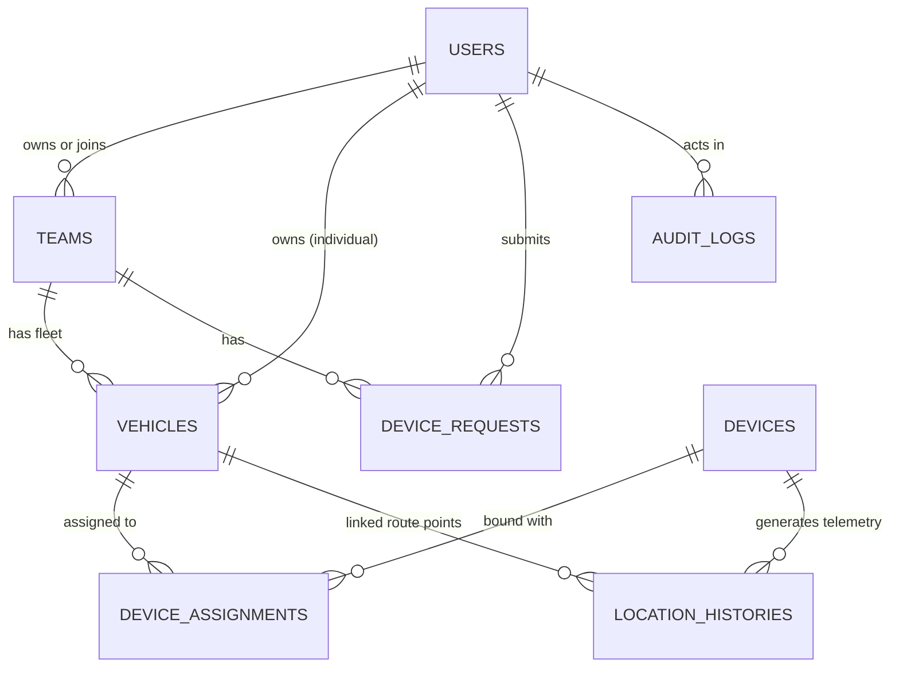

# Microi Database Schema

## 1. Schema Diagram & Relationships

## 2. Table Specifications

### `users`
- `id` (BIGINT, PK)
- `name` (VARCHAR)
- `email` (VARCHAR, Unique)
- `password` (VARCHAR, Hashed)
- `system_role` (VARCHAR: `super_admin`, `micromek_staff`, `customer`)
- `account_type` (VARCHAR: `individual`, `organization`)
- `phone_number` (VARCHAR, Nullable)
- `physical_address` (VARCHAR, Nullable)
- `onboarding_completed` (BOOLEAN, Default: false)
- `is_active` (BOOLEAN, Default: true)

### `teams` (Organizations)
- `id` (BIGINT, PK)
- `name` (VARCHAR)
- `slug` (VARCHAR, Unique)
- `is_personal` (BOOLEAN)
- `status` (VARCHAR: `pending`, `approved`, `rejected`, `suspended`)
- `org_type` (VARCHAR: `corporate`, `ngo`, `government`, `logistics`)
- `registration_number` (VARCHAR, Nullable)
- `contact_email` (VARCHAR, Nullable)
- `contact_phone` (VARCHAR, Nullable)
- `business_address` (TEXT, Nullable)
- `created_by` (BIGINT, FK -> users.id)
- `rejection_reason` (TEXT, Nullable)

### `vehicles`
- `id` (BIGINT, PK)
- `team_id` (BIGINT, FK -> teams.id, Nullable)
- `user_id` (BIGINT, FK -> users.id, Nullable)
- `plate_number` (VARCHAR, Unique)
- `name` (VARCHAR)
- `make` (VARCHAR)
- `model` (VARCHAR)
- `year` (VARCHAR, Nullable)
- `category` (VARCHAR: `sedan`, `suv`, `truck`, `van`, `motorcycle`, `drone`)
- `color` (VARCHAR, Nullable)
- `operational_notes` (TEXT, Nullable)
- `status` (VARCHAR: `active`, `maintenance`, `decommissioned`)

### `devices`
- `id` (BIGINT, PK)
- `device_id` (VARCHAR, Unique, Hardware identifier)
- `serial_number` (VARCHAR, Unique, Nullable)
- `model` (VARCHAR)
- `api_key_hash` (VARCHAR, Hashed token)
- `api_key_prefix` (VARCHAR, 16)
- `provisioning_status` (VARCHAR: `unprovisioned`, `provisioned`, `active`, `revoked`)
- `status` (VARCHAR: `active`, `inactive`)
- `last_seen_at` (TIMESTAMP, Nullable)
- `last_latitude` (DECIMAL 10,7, Nullable)
- `last_longitude` (DECIMAL 10,7, Nullable)
- `last_speed` (FLOAT, Nullable)
- `last_heading` (FLOAT, Nullable)
- `last_altitude` (FLOAT, Nullable)
- `battery_level` (FLOAT, Nullable)

### `device_assignments`
- `id` (BIGINT, PK)
- `device_id` (BIGINT, FK -> devices.id)
- `vehicle_id` (BIGINT, FK -> vehicles.id)
- `assigned_by` (BIGINT, FK -> users.id)
- `assigned_at` (TIMESTAMP)
- `unassigned_at` (TIMESTAMP, Nullable)
- `status` (VARCHAR: `active`, `terminated`)
- `notes` (TEXT, Nullable)

### `device_requests`
- `id` (BIGINT, PK)
- `team_id` (BIGINT, FK -> teams.id, Nullable)
- `user_id` (BIGINT, FK -> users.id)
- `vehicle_id` (BIGINT, FK -> vehicles.id)
- `status` (VARCHAR: `submitted`, `assigned`, `rejected`, `cancelled`)
- `reason` (TEXT, Nullable)
- `admin_notes` (TEXT, Nullable)
- `reviewed_by` (BIGINT, FK -> users.id, Nullable)
- `reviewed_at` (TIMESTAMP, Nullable)

### `location_histories`
- `id` (BIGINT, PK)
- `device_id` (BIGINT, FK -> devices.id)
- `vehicle_id` (BIGINT, FK -> vehicles.id, Nullable)
- `latitude` (DECIMAL 10,7)
- `longitude` (DECIMAL 10,7)
- `speed` (FLOAT, km/h)
- `heading` (FLOAT, degrees)
- `altitude` (FLOAT, meters)
- `accuracy` (FLOAT, meters)
- `satellites` (INTEGER, count)
- `battery` (FLOAT, percentage)
- `raw_payload` (JSON)
- `recorded_at` (TIMESTAMP, Index)

### `audit_logs`
- `id` (BIGINT, PK)
- `user_id` (BIGINT, FK -> users.id, Nullable)
- `action` (VARCHAR)
- `auditable_type` (VARCHAR, Nullable)
- `auditable_id` (BIGINT, Nullable)
- `old_values` (JSON, Nullable)
- `new_values` (JSON, Nullable)
- `ip_address` (VARCHAR)
- `user_agent` (VARCHAR)
